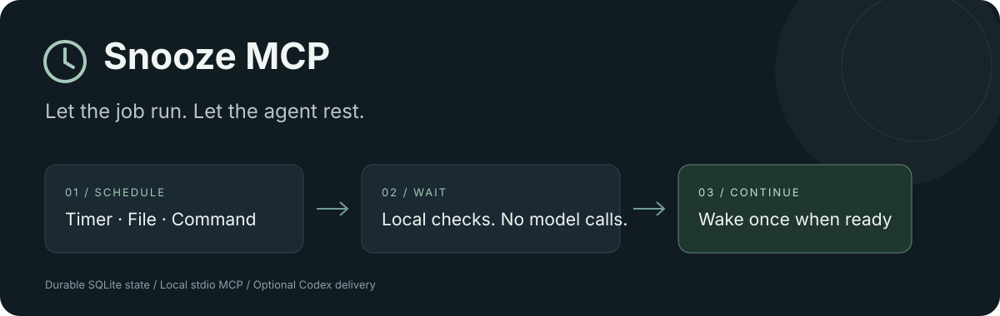

<p align="center">
  
</p>

<p align="center">
  <a href="https://github.com/Ameer-Jamal/snooze-mcp/actions/workflows/ci.yml"></a>
  <a href="https://github.com/Ameer-Jamal/snooze-mcp/releases"></a>
  
  <a href="LICENSE"></a>
</p>

# Snooze MCP

**Let the job run. Let the agent rest.**

A durable local scheduler for MCP agents waiting on external work. Save a timer,
watch a completion file, or run a small status probe. A background worker handles
the checks; an optional Codex adapter queues one continuation when the check
completes, fails, or expires.

**Waiting makes no model calls.** Resuming the agent uses its normal allowance.

[Get started](#get-started) · [Examples](docs/examples.md) ·
[Tools and CLI](docs/reference.md) · [Troubleshooting](docs/troubleshooting.md) ·
[Releases](https://github.com/Ameer-Jamal/snooze-mcp/releases)

## Why use it?

Builds, exports, and deployment checks often need time rather than more reasoning.
Repeatedly asking an agent “is it done?” adds model calls without helping the job
finish. Snooze moves that wait into an ordinary local process.

| Situation | Schedule |
| --- | --- |
| An export writes `export.done` when finished | Check the file every ten minutes |
| A status command reports build completion | Run a repeatable probe every hour |
| Work should start overnight | Queue one continuation at the chosen time |
| A process stays pending | Increase the interval up to a configured maximum |

**Early release.** Automated tests cover macOS and Linux; the local Codex wake path
has also been exercised end to end. Native Windows is unsupported. Other MCP
clients can schedule and read events; automatic delivery currently targets local
Codex chats only. [Compatibility and limitations](docs/architecture.md).

## Get started

You need **Python 3.11+**, **Git**, and macOS or Linux. Automatic wake-ups require
a signed-in local Codex CLI that supports `codex queue --help`. Snooze requires
no separate model API key.

### 1. Install

Use a dedicated environment in a stable location:

```sh
git clone https://github.com/Ameer-Jamal/snooze-mcp.git
cd snooze-mcp
git checkout v0.1.0
python3 -m venv .venv
.venv/bin/python -m pip install .
```

Or download a wheel from [GitHub Releases](https://github.com/Ameer-Jamal/snooze-mcp/releases)
and install it into your environment with `python -m pip install /path/to/file.whl`.
Distribution is through GitHub; a PyPI package is not required.

### 2. Connect MCP

From the clone directory:

```sh
codex mcp add snooze -- "$PWD/.venv/bin/snooze-mcp" serve
```

Reopen your client if the tools do not appear. For another MCP client, use the
absolute path to the installed executable and `args: ["serve"]`. Transport is
local stdio; there is no HTTP listener to expose.

### 3. Start the worker

On **macOS**, install the user LaunchAgent:

```sh
.venv/bin/snooze-service install
.venv/bin/snooze-mcp health
```

On **Linux**, run the worker in a second terminal for the first test:

```sh
.venv/bin/snooze-mcp worker
```

For unattended Linux use, run it under your service manager. The computer must
remain awake. Installing MCP alone does **not** keep the worker running.

### 4. Try it without model usage

```sh
.venv/bin/snooze-demo
```

The demo schedules a real MCP file check, simulates a three-second export, and
verifies the background worker's completion event. It makes no model calls.

From inside the intended Codex chat, opt into one real wake:

```sh
.venv/bin/snooze-demo --wake-current-chat
```

That option reads the calling chat's `CODEX_THREAD_ID` and uses normal Codex
allowance. Queue acceptance is separate from agent completion; confirm the
response in the destination chat.

## Ask your agent

> Use Snooze to watch `/absolute/path/to/export.done` every ten minutes. Check
> worker health first. Save what you should do when the export finishes, pass
> this chat's exact UUID as `thread_id`, and expire the check after one day.
> End this turn after scheduling and continue once when woken.

The agent chooses the check and cadence; Snooze executes the saved schedule.
It does not modify global agent instructions. An optional
[agent policy](docs/agent-policy.md) explains when to defer external waits.

## How it works

```text
Agent ── schedule_check ──▶ SQLite ◀── local worker
                                      │
                         timer / file / command check
                                      │
                         pending ─────┴──▶ wait and check later
                                      │
                          completed / failed / expired
                                      │
                         durable event + optional Codex queue
```

Jobs finish once. Terminal events are saved before delivery. Each wake gets
**one attempt**; there are no automatic retries that could duplicate AI work.
If delivery fails or is unknown, inspect the event and chat before retrying.
[Delivery semantics](docs/architecture.md#delivery).

## Operational boundaries

- Command probes run as your OS user. Use trusted, repeatable status checks;
  Snooze does not sandbox them. Arguments are passed without shell interpolation.
- Default probe timeout: 30 seconds; maximum: 300. Retained output is bounded to
  4 KiB plus a marker. Output above 1 MiB terminates the probe.
- Expiry bounds the wait, **not** the resumed AI task's runtime.
- Overnight starts can shift work outside your workday. Snooze does not measure,
  reserve, reset, or bypass account limits. [Overnight work](docs/examples.md#overnight-work).
- State stays local. A configured wake sends the saved continuation and bounded
  probe output to the chosen Codex chat.

## Development

```sh
.venv/bin/python -m pip install -e '.[dev]'
.venv/bin/ruff check .
.venv/bin/ruff format --check .
.venv/bin/python -m unittest discover -s tests -v
.venv/bin/python -m build
.venv/bin/python -m twine check dist/*
```

CI tests Python 3.11 and 3.13 on macOS and Linux, checks formatting, builds the
distributions, and tests wheel installation outside the checkout. Tests use
isolated state and mocked delivery; they do not call a model.

See [CONTRIBUTING.md](CONTRIBUTING.md), [SECURITY.md](SECURITY.md), and
[CHANGELOG.md](CHANGELOG.md) for contribution, security, and release details.

## Uninstall

```sh
.venv/bin/snooze-service uninstall  # macOS worker
codex mcp remove snooze
```

Stop any manually started worker too. Saved jobs remain in
`~/.local/share/snooze-mcp/`; restarting resumes active jobs. Cancel them first
if they should not resume. [State and upgrades](docs/troubleshooting.md).

## License

[MIT](LICENSE) © Ameer Jamal.
